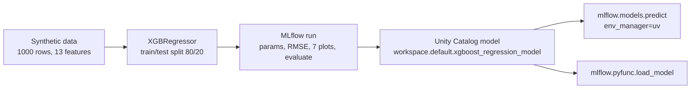

# Serving models on Databricks: MLflow 3 + Unity Catalog example

A Databricks notebook that shows the MLflow 3 model lifecycle on a small regression problem.
It generates synthetic data with non-linear effects and feature interactions, trains an
**XGBoost** regressor and logs it to an **MLflow** experiment. The run also gets parameters,
metrics and EDA plots, plus an `mlflow.models.evaluate` report. The model is registered in
**Unity Catalog** as `workspace.default.xgboost_regression_model` and then loaded back for
prediction. One prediction runs in an isolated `uv` environment, the other in-process with `pyfunc`.



## Results (from the saved notebook output)

| Metric | Value |
| --- | --- |
| Train RMSE | 0.9892 |
| Test RMSE | 7.5204 |

Training error is far lower than test error, so the default hyperparameters overfit this data.
The notebook installs Optuna but does not tune anything yet.

## Tech stack

Databricks (serverless notebook, Python 3.11), MLflow 3, Unity Catalog model registry,
XGBoost, scikit-learn, pandas, NumPy, matplotlib, seaborn.

## Repository structure

```
.
├── codeexamplerunexperiment.ipynb   # the Databricks notebook (data, training, MLflow logging, UC registration, inference)
├── requirements.txt                 # packages the notebook imports (for running outside Databricks)
└── LICENSE
```

## Prerequisites

The notebook is written for Databricks and **will not run end to end without a Databricks workspace**:

- A Databricks workspace with **Unity Catalog** enabled. `mlflow.set_registry_uri("databricks-uc")`
  only works there.
- A catalog `workspace` with a schema `default`, and permission to create models in it
  (`USE CATALOG`, `USE SCHEMA`, `CREATE MODEL`). To use another location, change
  `registered_model_name` and `model_uri`.
- Serverless compute or a cluster that allows `%pip install` and `%restart_python`. The notebook
  was saved from serverless environment version 2.
- Internet access from the compute so it can install `mlflow>=3.0`, `xgboost`, `optuna` and `uv`.
  `uv` is also needed for `env_manager="uv"`.

## Getting started

1. In your workspace, **Workspace > Import** the `.ipynb` file. Or clone this repo as a Git folder.
2. Attach serverless compute (or a cluster with Unity Catalog access).
3. Run all cells. The first cell installs the packages and restarts Python.
4. Open the MLflow experiment linked in the output to see the run, its metrics and plots. Open
   **Catalog > workspace > default > xgboost_regression_model** to see the registered version.

The notebook stops at a registered, loadable model. It does not create a **Model Serving endpoint**.
To get a REST endpoint, create one for the registered model in the Databricks Serving UI.

### Running outside Databricks

The data generation, training, MLflow logging and `pyfunc` loading also work against a local
MLflow store. To run them, skip the `%pip`/`%restart_python`, `set_registry_uri("databricks-uc")`
and `%sql` cells. Call `mlflow.set_tracking_uri("sqlite:///mlflow.db")` first, remove
`registered_model_name`, and load the model from `model_info.model_uri`. Run this way with
MLflow 3.18 and XGBoost 3.2, the notebook gives the same Train/Test RMSE as the table above.

```bash
pip install -r requirements.txt
```

## Data

All data is generated in the notebook (`create_regression_data`, seed 1994). No external dataset is needed.

## License

Released under the [MIT License](LICENSE).
